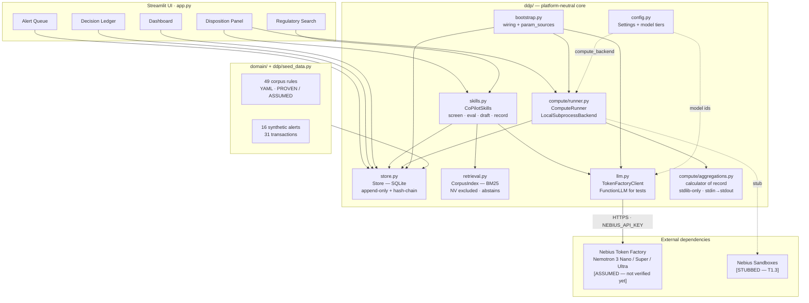
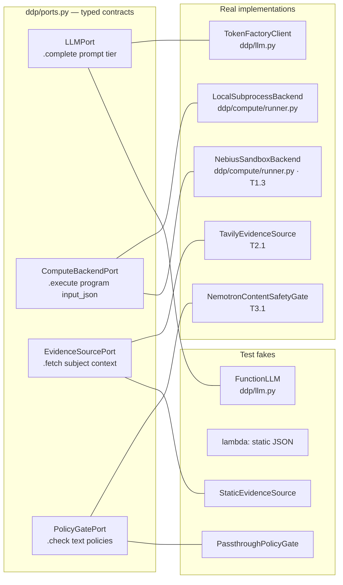
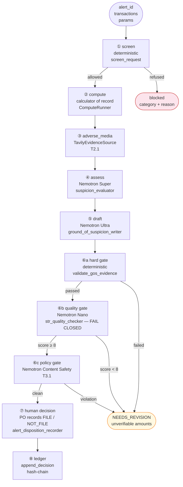
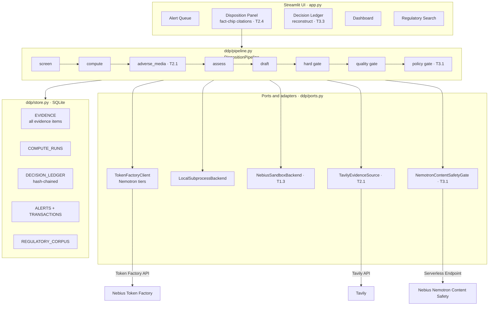

# Architecture — Twin Trace, Twin Trace

**Status:** Phase 1 design document  
**Date:** 2026-09-27  
**Claim level:** PROPOSED — all target-section items are design decisions for human confirmation.

---

## §1  As-Is Architecture

### Component diagram



### Data flow — one alert, end to end

```
seed_db
  └─ ALERTS + TRANSACTIONS + REGULATORY_CORPUS (49 rules) → SQLite

PO opens Alert Queue
  └─ Store.alerts_with_last_disposition()
  └─ SLA computed client-side (calendar heuristic)

PO opens Disposition Panel for ALERT-XX
  ① Calculator runs (every session, deterministically)
       ComputeRunner.run(alert_id, transactions, params)
         ├─ reads aggregations.py bytes  → CODE_SHA256
         ├─ LocalSubprocessBackend.execute()  → python -I in isolated subprocess
         └─ Store.append_compute_run(run)  →  COMPUTE_RUNS row with
              CODE_SHA256 · INPUT_SHA256 · OUTPUT_SHA256

  ② "Run AI Assessment" button
       CoPilotSkills.suspicion_evaluator(case_context)
         ├─ assembles prompt with KYC + transactions + alert signals
         ├─ TokenFactoryClient.complete(prompt, tier="reasoning")  →  Nemotron Super
         └─ _parse_json_array(raw)  →  11 {factor_id, assessment, evidence, rules_cited}
              [on parse failure: all 11 → insufficient_data]

  ③ "Draft GoS" button
       CoPilotSkills.ground_of_suspicion_writer(case_context, poe, computed)
         ├─ assembles prompt with triggered factors + COMPUTED FACTS block
         ├─ TokenFactoryClient.complete(prompt, tier="disposition")  →  Nemotron Ultra
         ├─ str_quality_checker(narrative, case_context, computed)
         │    ├─ LLM quality check (triage tier)  →  10-point checklist
         │    └─ validate_gos_evidence(narrative, transactions, facts)  [NO LLM]
         │         └─ every ₹ amount must be a txn amount or computed fact (±1%)
         └─ returns {narrative, quality_score, hard_gate_passed, status}

  ④ PO reviews + records decision
       CoPilotSkills.alert_disposition_recorder(alert_id, disposition, rationale, …)
         └─ Store.append_decision(fields)  →  DECISION_LEDGER row with
              PREV_HASH · ROW_HASH (sha256 chain)

Ledger page
  └─ Store.verify_ledger_chain()  →  {ok, rows, first_break_seq}
```

### External dependencies

| Dependency | Purpose | Status | Verified |
|---|---|---|---|
| Nebius Token Factory | Nemotron Nano / Super / Ultra via Chat Completions | ASSUMED | T0.4 |
| Nebius Sandboxes | Isolated compute for calculator | STUBBED | T1.3 |
| Python stdlib only (aggregations.py) | Calculator execution | PROVEN | offline |
| SQLite | All persistence | PROVEN | offline |
| Streamlit | UI framework | PROVEN | offline |

### Where numbers, citations and decisions are produced

| Production point | How | Evidence level |
|---|---|---|
| Transaction amounts | Seed data / real rows | PROVEN (data) |
| Computed facts (F-* IDs) | aggregations.py via LOCAL subprocess | PROVEN (local backend) |
| Corpus rule citations | BM25 index, PROVEN/ASSUMED only | PROVEN |
| POE factor assessments | Nemotron Super via Token Factory | ASSUMED (no live run) |
| GoS narrative | Nemotron Ultra via Token Factory | ASSUMED |
| Quality checklist | Nemotron Nano via Token Factory | ASSUMED |
| Hard gate (amount validation) | Pure Python, no LLM | PROVEN |
| Ledger row hash | sha256 over canonical fields + chain | PROVEN |

---

## §2  Critique — where current code would lose points

### Technological Implementation (tie-breaker)

| Gap | Impact | Task |
|---|---|---|
| **str_quality_checker fails open**: parse failure → all 10 items default to PASS, blocking nothing. | A judge reviewing the code sees a safety check that never fails. | T3.4 |
| **Nemotron prompts untuned**: prompts were written for Llama 3.3 70B. JSON reliability on Nemotron Super/Ultra/Nano is untested. | Up to 100% of live runs could produce parse failures. | T1.1 |
| **No structured output / JSON mode**: Token Factory may support `response_format: {"type": "json_object"}` — not verified. | Missing a simple reliability improvement. | T0.4 → T1.1 |
| **Calculator runs only locally**: NebiusSandboxBackend raises immediately; the ledger never has a real BACKEND_RUN_REF. | The claim "executed in Nebius Sandbox" cannot be made. | T1.3 |
| **No adverse-media evidence**: the Tavily integration is PLANNED. | The "assembled evidence" story is incomplete; a judge looking for Tavily use finds nothing. | T2.1–2.2 |
| **No policy gate**: Nemotron Content Safety custom policies are PLANNED. | The NVIDIA model depth story is thin (only generation, no verification). | T3.1 |
| **No per-alert run trace in UI**: model calls are recorded in session_state but not surfaced as a structured, exportable trace. | Judges cannot verify per-call provenance in the demo. | T4.1 |
| **No measured evaluation**: eval numbers cited in submission cannot exist until T3.2 runs. | README / Devpost text would have no performance claims. | T3.2 |
| **Prompt-injection surface**: Tavily results (once added) are untrusted web content; fencing must be explicit and tested. | Missing until T2.1. | T2.1 |

### Design

| Gap | Impact | Task |
|---|---|---|
| `design/` docs describe a fact-citation chip UX (hover → derivation + txn IDs); current UI shows a plain text line. | Design criterion will see the gap between spec and implementation. | T2.4 |
| No "Reconstruct decision" view (DECISION_ID → full audit trail). | The ledger page is a list, not an interactive audit tool. | T3.3 |
| Calculator panel shows hashes but no "Reproduce" button in the UI. | The reproducibility story requires a click to be credible in a demo. | T3.3 |
| AI recommendation is shown last (PROVEN). Evidence tabs could be cleaner (T4.1). | Minor; the principal invariant is met. | T4.1 |

### Potential Impact

| Gap | Impact | Task |
|---|---|---|
| Adverse-media screening missing means the copilot misses an important evidence dimension real POs would use. | Weaker "would this work in production?" story. | T2.1 |
| No performance numbers means the README cannot claim "X% fewer hallucinations" or "caught Y out of Z violations." | Submission is weaker on this criterion. | T3.2 |
| SLA clock uses a calendar-to-working-day proxy (×5/7); ignores Indian holidays. | Minor; noted in HANDOFF.md §5. | Post-deadline backlog |

### Quality of the Idea

| Gap | Impact | Task |
|---|---|---|
| The "non-obvious" element (proof-carrying figures) is already present. | Strong. | — |
| Sandbox calculator execution would deepen the story ("NVIDIA infrastructure executes the evidence"). | Missing until T1.3. | T1.3 |
| Content Safety custom policies would demonstrate the NVIDIA model in a verification role, not just generation. | Missing until T3.1. | T3.1 |

---

## §3  Target Architecture

### 3.1  Unified evidence model

Every fact the product may rely on is an **evidence item** stored in a new `EVIDENCE` table:

| Field | Purpose |
|---|---|
| `EVIDENCE_ID` | stable identifier cited in assessments and GoS |
| `ALERT_ID` | the alert this evidence belongs to |
| `TYPE` | `transaction` · `computed_fact` · `adverse_media` · `corpus_rule` · `policy_verdict` |
| `SOURCE` | e.g. `seed_data.v1` · `aggregations.v1:RUN-abc` · `tavily.search:2026-10-05` |
| `CONTENT_HASH` | sha256 of CONTENT_JSON (for chain-of-custody) |
| `CONTENT_JSON` | the fact value (amount, snippet, rule text, verdict) |
| `PROVENANCE_JSON` | run ID, query, URL, model call — depends on type |
| `CREATED_AT` | ISO timestamp |

**Decision:** new EVIDENCE table, not views over existing tables.  
*Rationale:* Adverse media results and policy verdicts have no existing home. Views over TRANSACTIONS and COMPUTE_RUNS would not generalise. The new table is additive (no migration, `CREATE TABLE IF NOT EXISTS`).

The existing TRANSACTIONS and COMPUTE_RUNS tables remain unchanged; they are operational records. EVIDENCE is the declarative, audit-facing view of what was presented to the reasoning system. GoS claims and DECISION_LEDGER entries cite EVIDENCE_IDs.

### 3.2  Ports and adapters



### 3.3  Disposition pipeline



**Fail-closed principle:** at each gate, an error or parse failure defaults to BLOCK, not PASS.  
**Human-in-the-loop:** the pipeline pauses at ⑦. The AI recommendation (from ④ `evidence_sufficiency_summary`) is shown last (anti-anchoring invariant).  
**Resume:** each step writes its output to EVIDENCE and/or session state; a crashed pipeline can restart from ② without re-running ①.

### 3.4  Model tier policy

| Step | Tier | Model (ASSUMED) | Rationale | Token budget / alert |
|---|---|---|---|---|
| ① screen | none | — | keyword-only, no LLM | 0 |
| ② compute | none | — | isolated subprocess | 0 |
| ③ adverse_media | none | — | Tavily API | 0 |
| ④ assess | reasoning | Nemotron 3 Super 120B-A12B | factor-by-factor reasoning over case evidence | ~3 000 in + ~800 out |
| ⑤ draft | disposition | Nemotron 3 Ultra 550B-A55B | GoS is the legally consequential narrative | ~2 500 in + ~500 out |
| ⑥b quality | triage | Nemotron 3 Nano 30B-A3B | 10-item checklist, fast and cheap | ~2 000 in + ~400 out |
| ⑥c policy | n/a | Nemotron Content Safety | Custom-policy gate; separate endpoint | ~500 per check |
| **Total** | | | | **~10 000 tokens / alert** |

**Fallback:** if the disposition tier (Ultra) is unavailable, downgrade to reasoning (Super) and record the fallback in the run trace. Never silently omit the fallback from the ledger.

### 3.5  Structured output strategy

1. **Verify at T0.4** whether Token Factory supports `response_format: {"type": "json_object"}` for the three Nemotron models.
2. **If JSON mode is supported:** pass `response_format={"type": "json_object"}` on every call that expects a JSON array (`suspicion_evaluator`, `str_quality_checker`). The instruction "Output ONLY the JSON array" stays in the prompt as a belt-and-braces guard.
3. **If not supported:** keep schema-in-prompt + `_parse_json_array` + **one repair retry**: on parse failure, retry the same prompt with the raw output appended and "Return only the JSON array, corrected." Do not retry more than once.
4. **On second failure:** `str_quality_checker` → all 10 items FAIL (score 0, NEEDS_REVISION). `suspicion_evaluator` → all 11 factors `insufficient_data`. **Never silently default to PASS.** Record the parse failure count in the run trace.

### 3.6  Deployment topology

**Decision:** Streamlit Community Cloud (free tier) + Nebius Token Factory API.

- **Cost:** free until the Community Cloud deprecates the app (well beyond Dec 15 judging cutoff).
- **Persistence:** per-session in-memory SQLite for the demo (no shared state, no multi-viewer races). The evaluator sees a clean state on every visit, pre-seeded with the 16 synthetic alerts.
- **Secrets:** `NEBIUS_API_KEY` and `TAVILY_API_KEY` stored in the Streamlit Community Cloud Secrets panel (not committed).
- **Nebius Cloud option (T4.2):** if the "runs on Nebius" story needs strengthening for judging, a Nebius DevPod or Serverless Endpoint can host the app. Evaluate cost at T4.2; if >$5/day, stay on Community Cloud and note it in the README.

### 3.7  Security

| Concern | Control |
|---|---|
| Prompt injection from case text | Fenced in prompts with "untrusted case data" label (already in suspicion_evaluator). Same fence required for Tavily snippets in Phase 4. |
| Prompt injection from Tavily web content | Tavily results are stored as evidence items; only the `snippet` (bounded length) enters any prompt, always inside an explicit untrusted-data block. A dedicated injection test in T2.1. |
| PII in ledger | Synthetic data only. METADATA_JSON stores model provenance, not prompt text or response reasoning traces. Reasoning traces (len only) are captured in `last_call["reasoning_chars"]` but not persisted. |
| API key exposure | Never logged, never written to any store row, never passed to the calculator. |

### 3.8  Observability

A **RunTrace** (defined in `ddp/pipeline.py`) accumulates per-step results:

```
RunTrace {
  alert_id, started_at,
  steps: [
    { name, status, latency_s, model_call: {tier, model, usage, latency_s}, blocked_reason }
  ],
  total_latency_s, total_prompt_tokens, total_completion_tokens, estimated_cost_usd
}
```

The UI shows the trace in a collapsible "Run trace" expander on the Disposition Panel. It is also exportable as JSON (for the video and the eval harness).

---

## §4  Target component diagram


