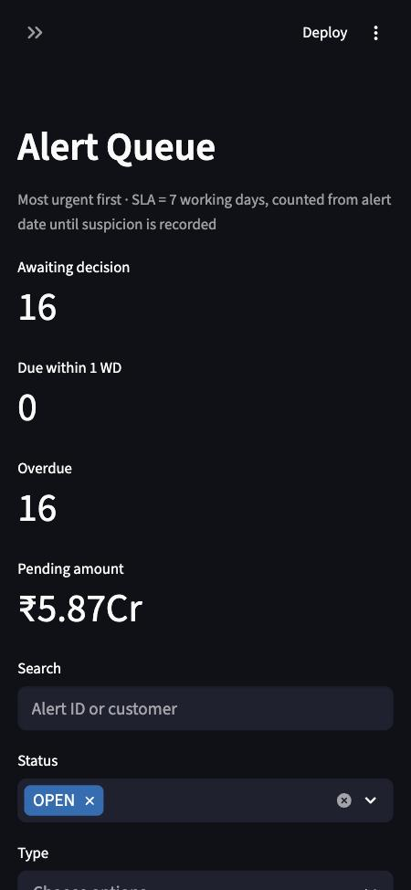
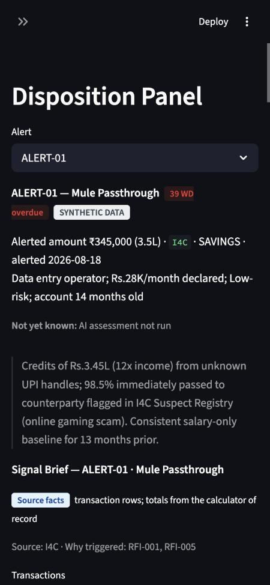
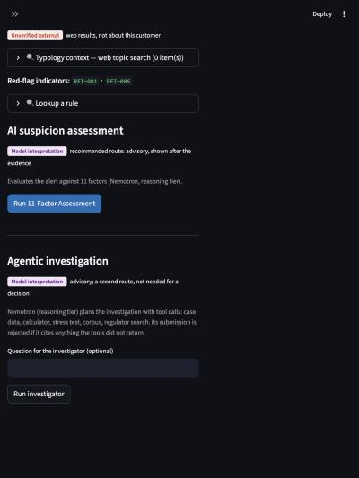

# User journey

**Queue → inspect evidence → challenge assumptions → draft and review → check the current text →
confirm the decision → reconstruct.**

All data is synthetic. Screenshots were taken on 2026-10-21 in the in-app browser.

## 1. Queue
Alerts sorted by urgency (SLA in working days). *Review →* opens the case.

## 2. Case header
Case identity, SLA, a **SYNTHETIC DATA** badge, the KYC line, and **Not yet known** (assessment
not run, factors with insufficient data, calculator warnings). The calculator runs on first view;
it is deterministic and local, with no model call.

## 3. Evidence (left column; first on narrow screens)
Each section carries a text label for the kind of statement it holds:

| Label | Sections |
|---|---|
| Source facts | Signal Brief (totals are calculator facts), Calculator of record |
| Product heuristic | Decision sensitivity (stress test) |
| Unverified external | Typology context (Tavily topic search; never about this customer) |
| Model interpretation | AI suspicion assessment (recommended route), Agentic investigation (optional second route) |
| Officer conclusion | Ground of Suspicion, Decision |

The AI recommendation appears after the evidence (anti-anchoring invariant).

## 4. Challenge assumptions
*Run stress test* shows the **modeled signal level**, each assumption that would lower it, the
level it leads to, and the evidence that would confirm it. It also shows the run budget, and
lists what the analysis does not cover. HIGH is not a finding; LOW is not innocence. For NOT_FILE
decisions it suggests reopen conditions, which are advisory: nothing monitors them.

## 5. Draft and review
Write the Ground of Suspicion, or start from an AI draft. Below the text, **Figures in this
text** re-checks the current text on every change. Each figure is labelled Verified
calculation, Source transaction, Needs review, Unsupported claim or Unreadable figure, with its
source rows, derivation and run. Sentences no automatic check covers are listed. The model
quality score is marked **NOT RE-CHECKED** when the text changes after it was checked.

## 6. Confirm the decision
*Record decision to file*, *Close without filing* or *Defer* opens a confirmation box with:
the exact text (read-only), officer ID (self-asserted), suspicion time, STR reference (shown
as *pending* until filed in FINGate), figure check result and policy flags. If anything needs
review, the officer must tick an acknowledgement. **Confirm and record** writes one ledger row
and sets the alert status in one transaction. Repeating it says *Already recorded*. Nothing is
sent to FIU-IND.

The recorder re-checks the text itself. Unsupported figures or customer-disclosure language are
refused even if the UI was bypassed.

## 7. Reconstruct
Decision Ledger → decision → *Reconstruct decision*: compute run hashes, **Reproduce** (from the
saved input and archived program; *unavailable* for older runs), model calls with tokens, rules
cited, and **Download decision package** (see `DECISION_PACKAGE.md`).

## States

| Situation | What the officer sees |
|---|---|
| No model key | AI sections say models are not configured; everything else works |
| Model call failed | Sidebar: *last call failed (rate_limited / timeout / …)*; the section shows the error |
| Assessment unparseable | 11 placeholder factors marked as a fallback, not as a result |
| Web search failed | *Last screen did not run (timeout …)*, not "no results" |
| Public demo budget used | *Demo model-call budget … used for this session* |

## Responsive and accessibility checks (2026-10-21)

| Width | Result |
|---|---|
| 375px | sidebar starts collapsed; order: header → evidence → sensitivity → external → AI → draft → decision; no horizontal scroll |
| 768px | stacked; no horizontal scroll; labels readable |
| desktop pane (~800–1300px) | two columns; decision buttons stacked full width |

Text labels carry meaning; colour is never the only signal. Decision buttons follow the
evidence in DOM and keyboard order. **Not done:** a screen-reader pass, a keyboard-only
walkthrough, and a usability session with a real officer.
